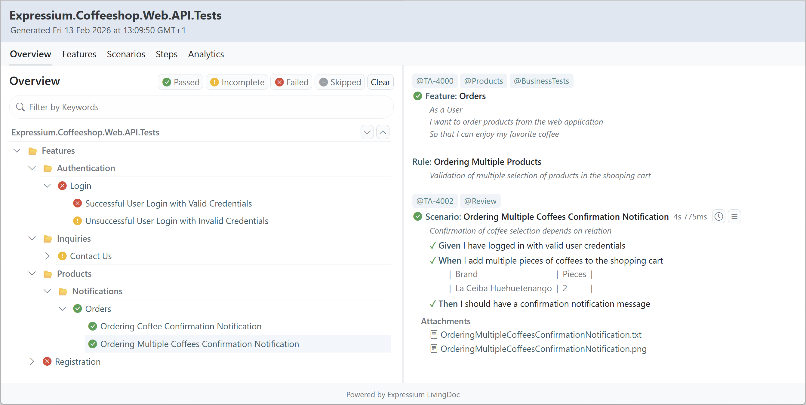
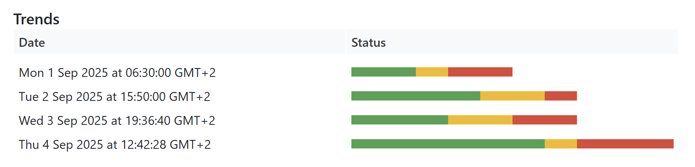
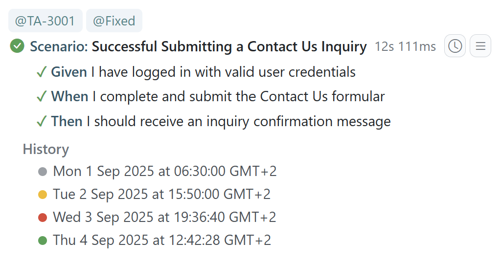
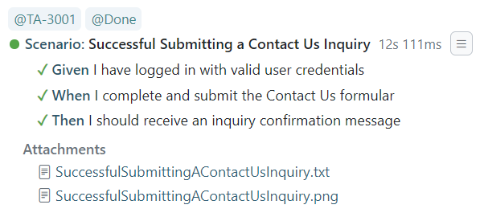
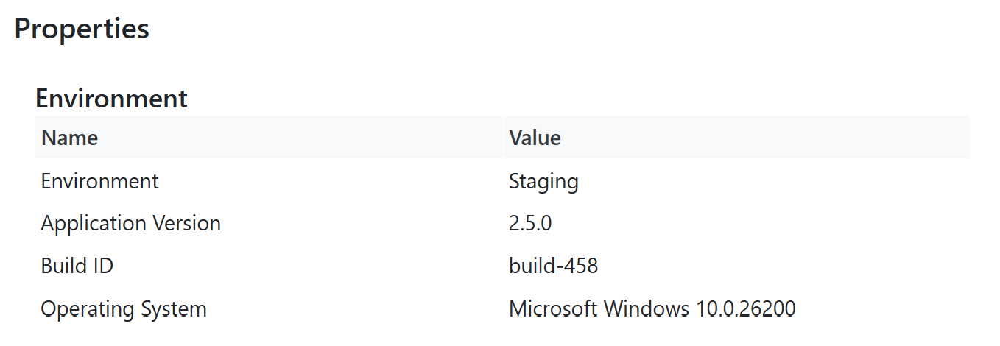
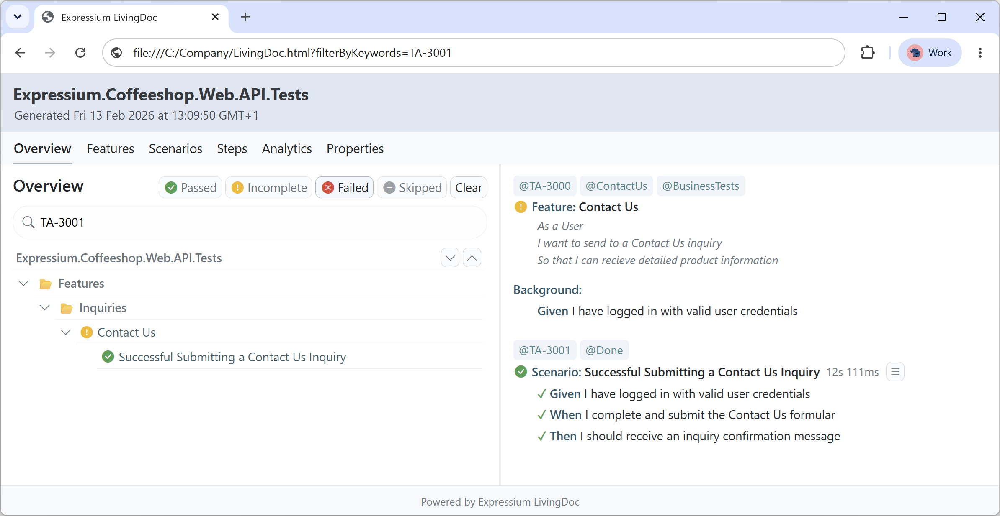
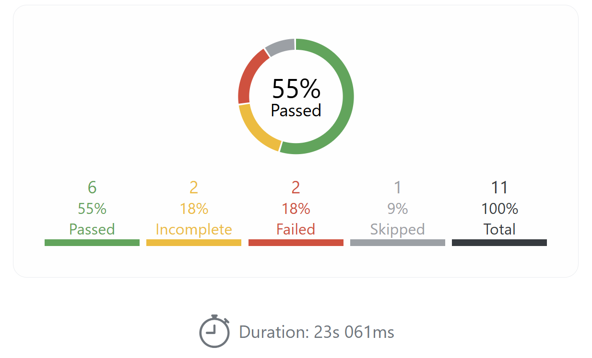
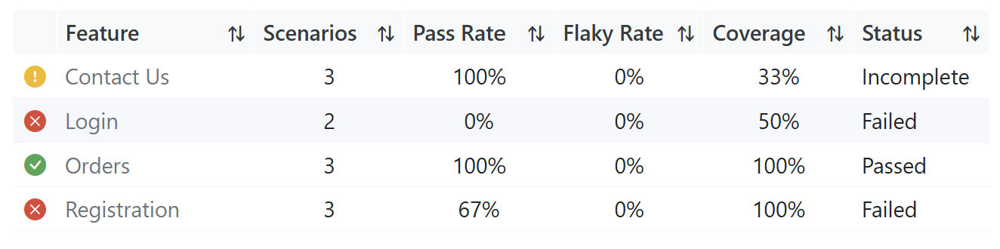
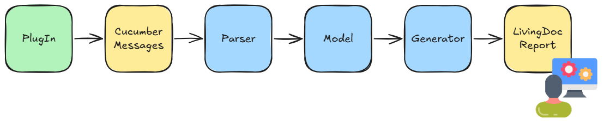

# Expressium LivingDoc

## Table of Contents
- [Introduction](#introduction)
- [Getting Started](#getting-started)
- [History Insights](#history-insights)
- [Scenario Attachments](#scenario-attachments)
- [Project Properties](#project-properties)
- [Command Line Interface](#command-line-interface)
- [Merging Reports](#merging-reports)
- [Deep Linking](#deep-linking)
- [Analytics Metrics](#analytics-metrics)
- [The LivingDoc Process](#the-livingdoc-process)

## Introduction
> Expressium LivingDoc — Reporting, Analytics and Living Documentation for ReqnRoll

Expressium LivingDoc is an open-source tool that combines reporting, analytics, and living documentation
into a single HTML test report for ReqnRoll projects. 
It transforms automated test results into meaningful insights and living documentation. 
The generated test report can be shared with quality and product stakeholders, 
providing clear visibility into the current state of product quality.

<br />
<p align="center">

</p>

**Example:** [https://expressium.dev/livingdoc/LivingDoc.html](https://expressium.dev/livingdoc/LivingDoc.html)

## Getting Started
Once you have created a ReqnRoll test project, integrating Expressium LivingDoc is straightforward.
Simply add the Expressium LivingDoc PlugIn NuGet package to your project and configure the ReqnRoll formatter. 
The formatter configuration supports relative paths and predefined ReqnRoll substitution variables.

* Add the Expressium.LivingDoc.ReqnrollPlugin NuGet package to the ReqnRoll test project...
* Setup the Expressium formatters properties in the ReqnRoll configuration in the test project...
* Run the tests in the ReqnRoll test project and open the HTML report in the output directory...

***NuGet Package***
```bash
dotnet add package Expressium.LivingDoc.ReqnrollPlugin
```

***ReqnRoll.json***
```json
{
  "$schema": "https://schemas.reqnroll.net/reqnroll-config-latest.json",
  "formatters": {
    "expressium": {
      "outputFilePath": "LivingDoc.ndjson",
      "outputFileTitle": "Expressium.Coffeeshop.Web.API.Tests"
    }
  }
}
```

## History Insights
The Expressium LivingDoc report can optionally include historical test results 
based on previous Cucumber Messages files.
Historical test results are visualized as trends in Analytics
along with a date-based status list within each scenario.

An additional health status — Broken, Regressed, Flaky, New, or Fixed —
is derived from historical results and displayed in the scenario tags.
The history analysis is limited to the four most recent test runs.
In a pipeline, the previous Cucumber message files
must be preserved in the history folder before executing the tests.

***ReqnRoll.json***
```json
{
  "$schema": "https://schemas.reqnroll.net/reqnroll-config-latest.json",
  "formatters": {
    "expressium": {
      "outputFilePath": "LivingDoc.ndjson",
      "outputFileTitle": "Expressium.Coffeeshop.Web.API.Tests",
      "historyPath": "History/*.ndjson"
    }
  }
}
```

<br />
<p align="center">

</p>

<p align="center">

</p>

## Scenario Attachments
Since the AddAttachment API in ReqnRoll doesn’t support adding attachments as external links,
we need to use a workaround to enable attachments in the Expressium LivingDoc report.
Scenario attachments, such as log files and screenshots, can be stored in a relative location
and added as links to simplify distribution afterwards.

***ReqnRollExtensions.cs***
```c#
using Reqnroll;

namespace MyCompany.MyProject.Web.API.Tests
{
    internal static class ReqnRollExtensions
    {
        internal static void AddAttachmentAsLink(this IReqnrollOutputHelper outputHelper, string path)
        {
            outputHelper.WriteLine($"[Attachment: {path}]");
        }
    }
}
```

<br />

***BaseHook.cs***
```c#
[AfterScenario]
public void AfterScenario()
{
    FinalizeFixture();

    if (configuration.Loggings)
    {
        var fileName = Path.Combine(Folders.Loggings.ToString(), GetTestName() + ".log");
        reqnrollOutputHelper.AddAttachmentAsLink(fileName);
    }

    if (configuration.Screenshots)
    {
        var fileName = Path.Combine(Folders.Screenshots.ToString(), GetTestName() + ".png");
        reqnrollOutputHelper.AddAttachmentAsLink(fileName);
    }
}
```

<br />
<p align="center">

</p>

## Project Properties
The Expressium LivingDoc report can be enriched with project properties defined in an external JSON file
generated during test execution and will be shown as a separate view of the report.
Properties are organized in named sections, and each section is rendered as its own table.

***ReqnRoll.json***
```json
{
  "$schema": "https://schemas.reqnroll.net/reqnroll-config-latest.json",
  "formatters": {
    "expressium": {
      "outputFilePath": "LivingDoc.ndjson",
      "outputFileTitle": "Expressium.Coffeeshop.Web.API.Tests",
      "propertiesFilePath": "Properties.json"
    }
  }
}
```

<br />

***BaseHook.cs***
```c#
[BeforeTestRun]
public static void BeforeTestRun()
{
    var properties = new LivingDocProperties();

    var environmentSection = new LivingDocPropertySection { Name = "Environment" };
    environmentSection.Properties.Add(new LivingDocProperty { Name = "Environment", Value = Environment.GetEnvironmentVariable("BUILD_ENVIRONMENT") });
    environmentSection.Properties.Add(new LivingDocProperty { Name = "Application Version", Value = Environment.GetEnvironmentVariable("APPLICATION_VERSION") });
    environmentSection.Properties.Add(new LivingDocProperty { Name = "Build ID", Value = Environment.GetEnvironmentVariable("BUILD_BUILDID") });
    environmentSection.Properties.Add(new LivingDocProperty { Name = "Operating System", Value = Environment.GetEnvironmentVariable("AGENT_OS") });
    properties.Sections.Add(environmentSection);

    var testRunSection = new LivingDocPropertySection { Name = "Test Run" };
    testRunSection.Properties.Add(new LivingDocProperty { Name = "Run ID", Value = Environment.GetEnvironmentVariable("BUILD_BUILDNUMBER") });
    testRunSection.Properties.Add(new LivingDocProperty { Name = "Run Name", Value = Environment.GetEnvironmentVariable("BUILD_DEFINITIONNAME") });
    testRunSection.Properties.Add(new LivingDocProperty { Name = "Triggered By", Value = Environment.GetEnvironmentVariable("BUILD_REASON") });
    testRunSection.Properties.Add(new LivingDocProperty { Name = "Git Commit", Value = Environment.GetEnvironmentVariable("BUILD_SOURCEVERSION") });
    properties.Sections.Add(testRunSection);

    var propertiesJson = System.Text.Json.JsonSerializer.Serialize(properties, new System.Text.Json.JsonSerializerOptions { WriteIndented = true });
    File.WriteAllText(Path.Combine(Directory.GetCurrentDirectory(), "Properties.json"), propertiesJson);
}
```

<br />
<p align="center">

</p>

## Command Line Interface
For many different purposes, it may be desirable to customize the final Expressium LivingDoc test report.
You can achieve this by creating a separate custom CLI project, adding a project reference to the ReqnRoll test project
and implementing any logic needed to handle your specific reporting requirements.
For other examples of custom CLI implementations, 
please refer to the Expressium LivingDoc CLI project and batch files in this repository.

***Program.cs***
```c#
if (args.Length == 7 && args[0] == "--custom")
{
    // Generating a custom LivingDoc Test Report based on a Cucumber Messages NDJSON file...
    Console.WriteLine("");
    Console.WriteLine("Generating LivingDoc Test Report...");
    Console.WriteLine("Input: " + args[2]);
    Console.WriteLine("Output: " + args[4]);
    Console.WriteLine("Title: " + args[6]);

    var livingDocConverter = new LivingDocConverter();
    var livingDocProject = livingDocConverter.Convert(args[2], args[6]);

    // Omitting overview folders...
    foreach (var feature in livingDocProject.Features)
        feature.Uri = null;

    livingDocConverter.Generate(livingDocProject, args[4]);

    Console.WriteLine("Generating LivingDoc Report Completed");
    Console.WriteLine("");
}
```

## Merging Reports
The ReqnRoll test execution may run across multiple pipelines
and it is desirable to produce a single consolidated test report.
A merging of test reports can be achieved through a separate CLI program.
Only new and previously unknown features will be included during the merge process.

***Program.cs***
```c#
if (args.Length == 8 && args[0] == "--merge")
{
    // Generating a LivingDoc Test Report based on Two Cucumber Messages NDJSON files...
    Console.WriteLine("");
    Console.WriteLine("Generating LivingDoc Test Report...");
    Console.WriteLine("InputMaster: " + args[2]);
    Console.WriteLine("InputSlave: " + args[3]);
    Console.WriteLine("Output: " + args[5]);
    Console.WriteLine("Title: " + args[7]);

    var livingDocConverter = new LivingDocConverter();
    var livingDocProject = livingDocConverter.Convert(args[2], args[7]);
    livingDocConverter.MergeProject(livingDocProject, args[3]);
    livingDocConverter.Generate(livingDocProject, args[5]);

    Console.WriteLine("Generating LivingDoc Report Completed");
    Console.WriteLine("");
}
```

## Deep Linking
When the Expressium LivingDoc report is opened in a browser,
the onload event automatically reads URL query parameters and applies filters accordingly.
This enables direct linking to specific scenarios or features filtered by keywords within the LivingDoc report.

***DeepLinking.bat***
```bat
start chrome "file:///C://Company/LivingDoc.html?filterByKeywords=TA-3001"
```

<br />
<p align="center">

</p>

## Analytics Metrics
Test automation analytics is the practice of collecting, aggregating, and interpreting data from automated test executions to make decisions about software quality, release readiness, and engineering efficiency.
The Expressium LivingDoc report provides an overview of test execution results, including the following metrics...

<p align="center">

</p>

<p align="center">

</p>

- **Passed Percentage** = Percentage of all scenarios that passed.
- **Failed Percentage** = Percentage of all scenarios that failed.
- **Incomplete Percentage** = Percentage of all scenarios that were incomplete.
- **Skipped Percentage** = Percentage of all scenarios that were skipped.
- **Duration** = Total test execution time from first test start to last test finish.
- **Pass Rate** = Percentage of executed scenarios with a passed result.
- **Flaky Rate** = Percentage of all scenarios classified as flaky.
- **Coverage** = Percentage of all executed scenarios with a passed or failed result.

## The LivingDoc Process
The Expressium LivingDoc process uses the Reqnroll PlugIn to capture test execution results and output them as Cucumber Messages (NDJSON).
These messages are parsed into an object-oriented model, which the Generator transforms into a self-contained HTML LivingDoc test report.

<br />
<p align="center">

</p>
